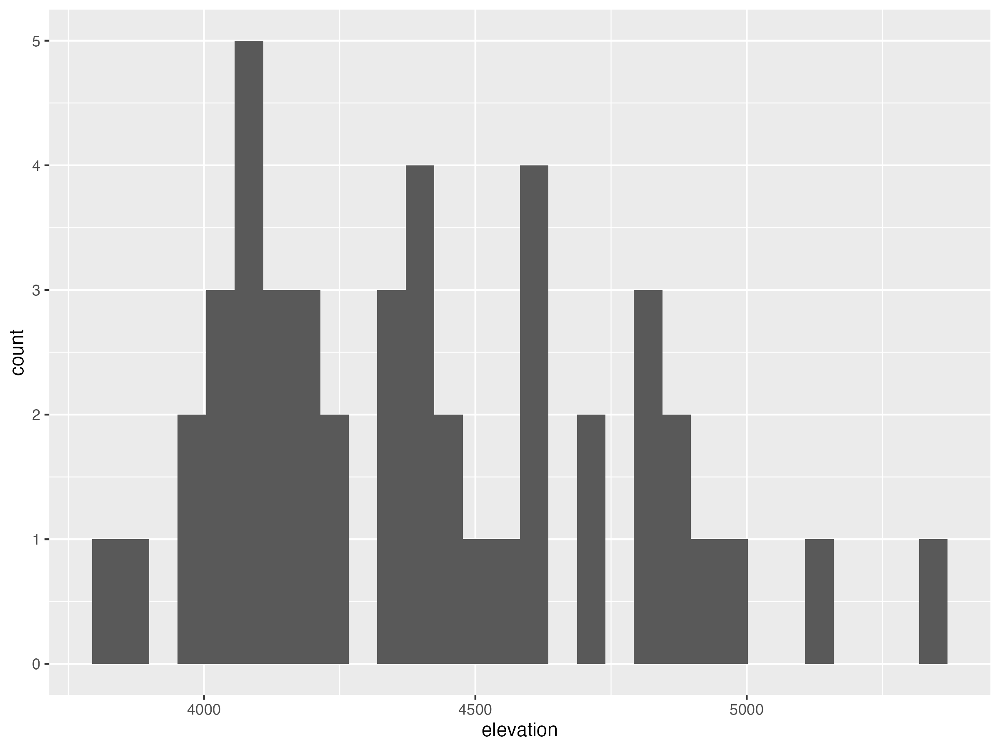
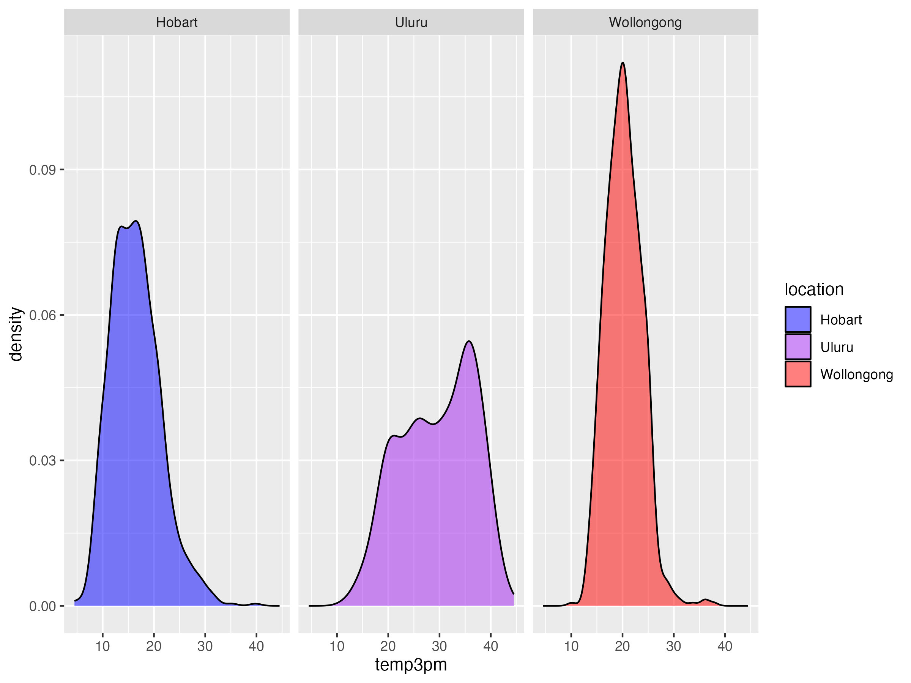
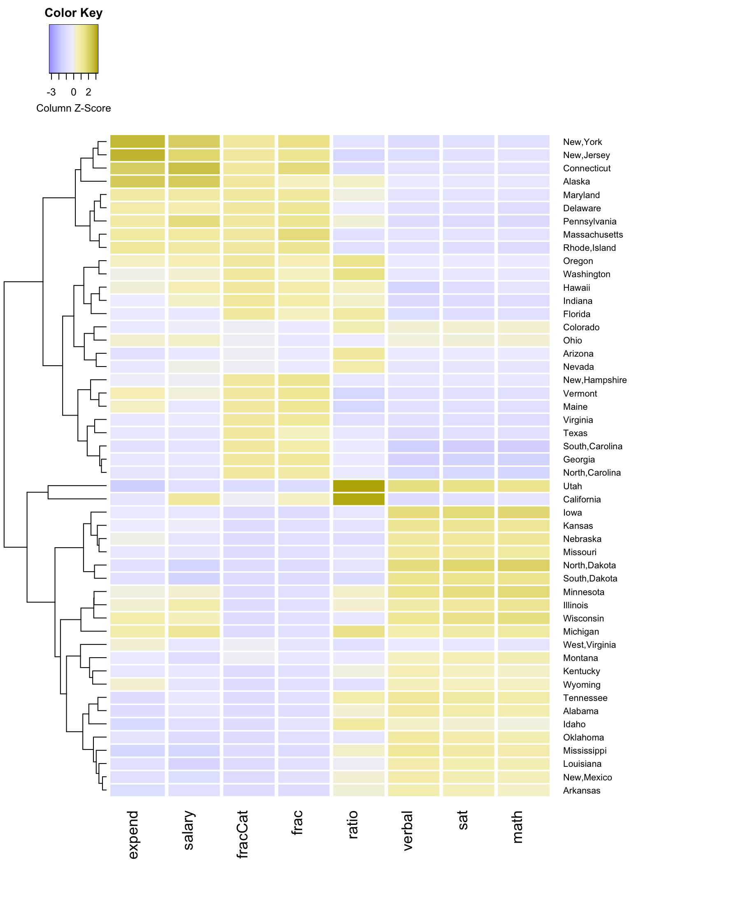
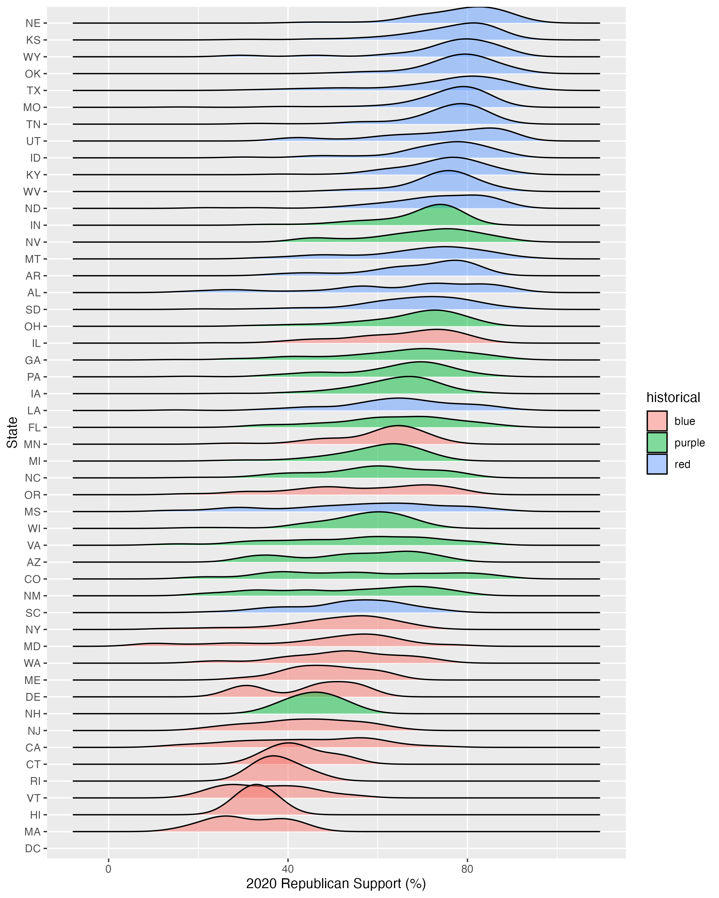
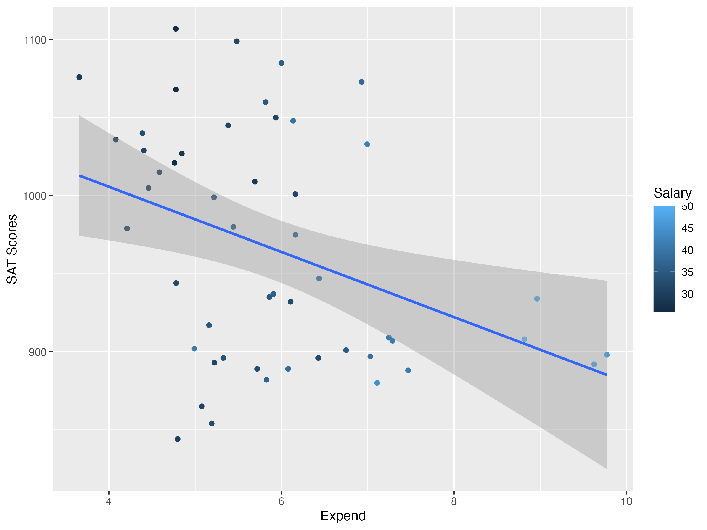
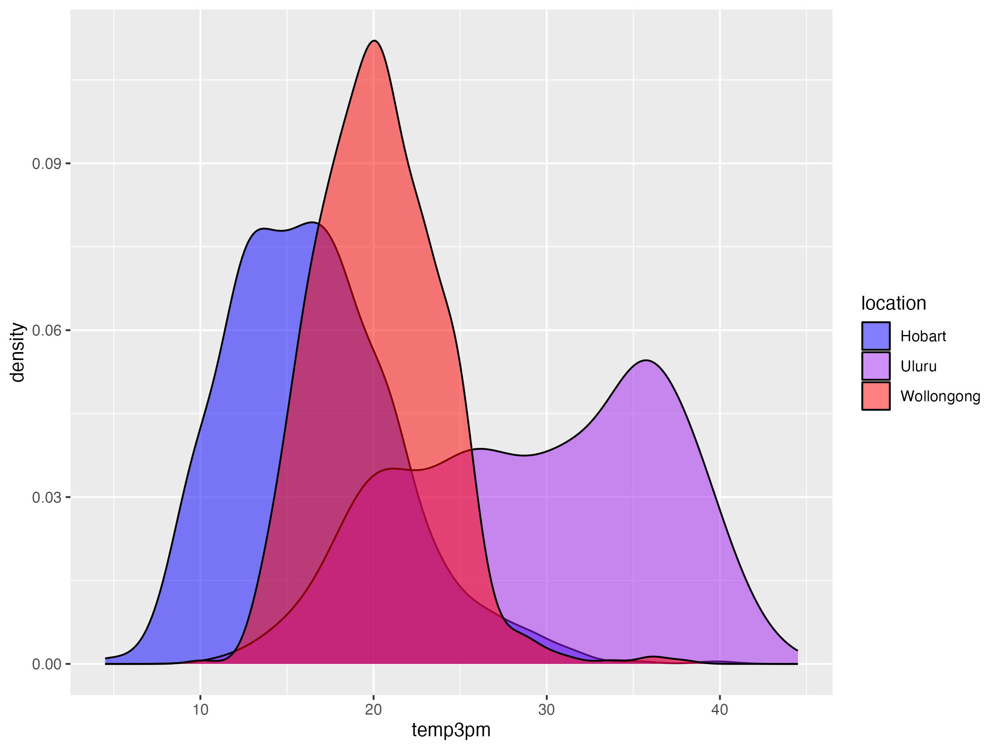
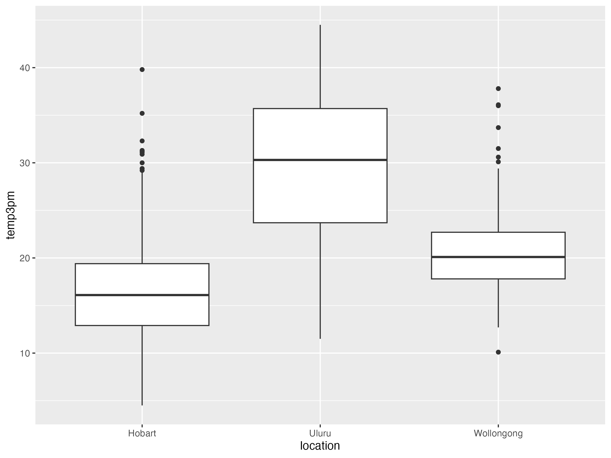

<section class="sq-hero">

COMP / STAT 112

<h1>
In Class Activities
</h1>

A collection of class work, visual experiments,
and beautiful figures I learned so far.

</section>

<section class="sq-project">

03
UNIVARIATE VISUALIZATION

ONE VARIABLE

FOUNDATIONS OF GGPLOT

<h2>Starting with one variable.</h2>

Bar charts, histograms, and density plots helped me understand
how different types of variables need different visual approaches.
This was also where I started getting comfortable with ggplot.

<a class="sq-button" href="03-univariate-viz-exercises.html">
View activity ↗
</a>

</section>

<section class="sq-project">

04
BIVARIATE VISUALIZATION

TWO VARIABLES

RELATIONSHIPS

<h2>Looking at how variables move together.</h2>

This activity moved from individual variables to relationships:
scatterplots, grouped distributions, boxplots, smooth trends,
and different ways to compare two variables.

<a class="sq-button" href="04-bivariate-viz-exercises.html">
View activity ↗
</a>

</section>

<section class="sq-project">

05
MULTIVARIATE VISUALIZATION

  

THREE + VARIABLES

ADDING COMPLEXITY

<h2>Adding another layer.</h2>

Color, shape, facets, heat maps, and star plots gave me more ways
to show multiple variables at once without losing the main story.

<a class="sq-button" href="05-multivariate-viz.html">
View activity ↗
</a>

</section>

<section class="sq-project">

06
SPATIAL VISUALIZATION

MAPS

LOCATION + DATA

<h2>Putting data on a map.</h2>

Leaflet, point maps, contour maps, and choropleths introduced
a different way to think about data: not only what happened,
but where.

<a class="sq-button" href="06-spatial-viz.html">
View activity ↗
</a>

</section>

<section class="sq-next">

STILL GROWING

<h2>
More work will 
live here soon.
</h2>

Effective visualization, wrangling,
and whatever comes next.

This page will keep growing as the semester continues.

</section>

<footer class="sq-footer">

<a href="../index.html">← Home</a>

COMP / STAT 112 · FALL 2026

</footer>

