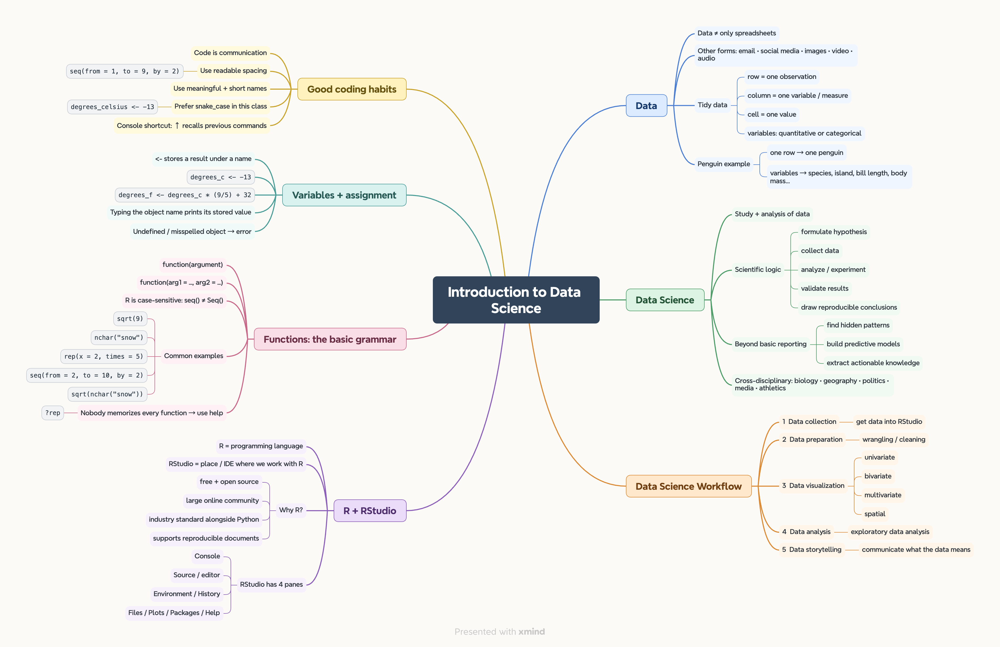
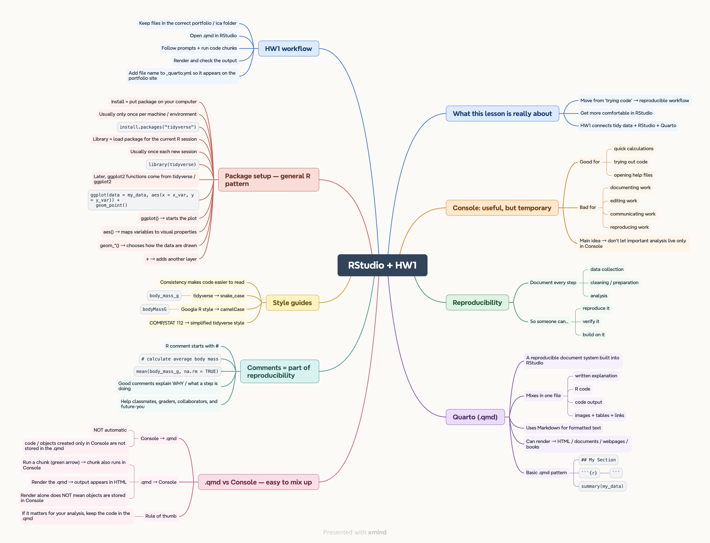
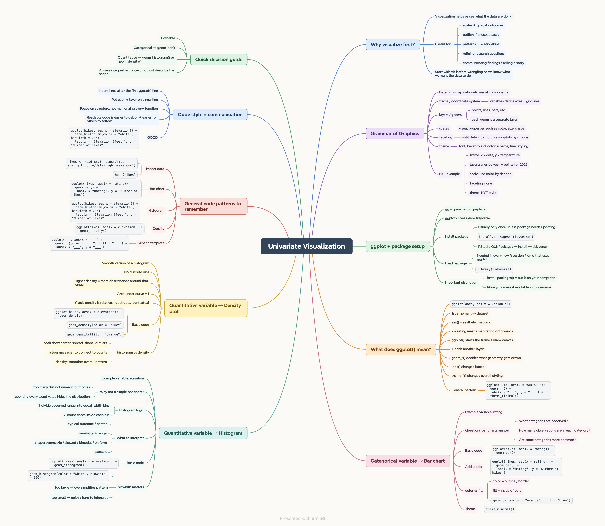
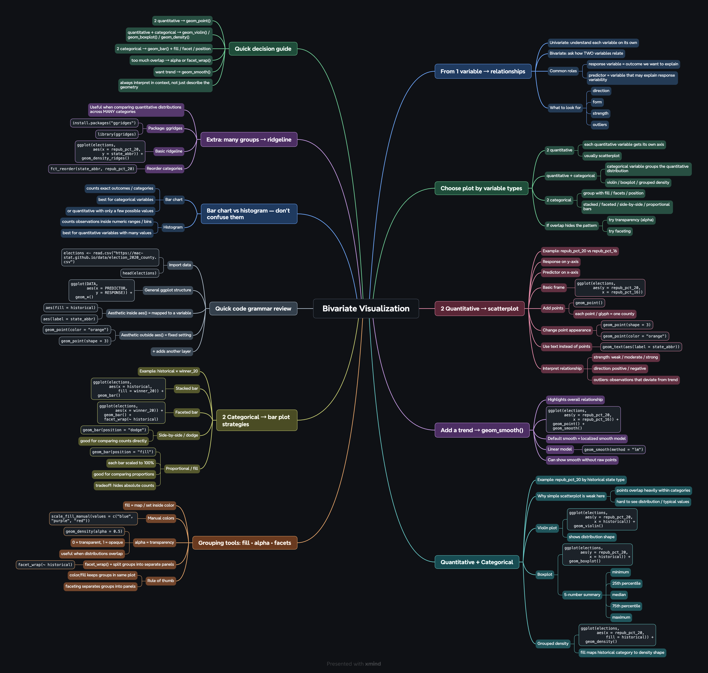
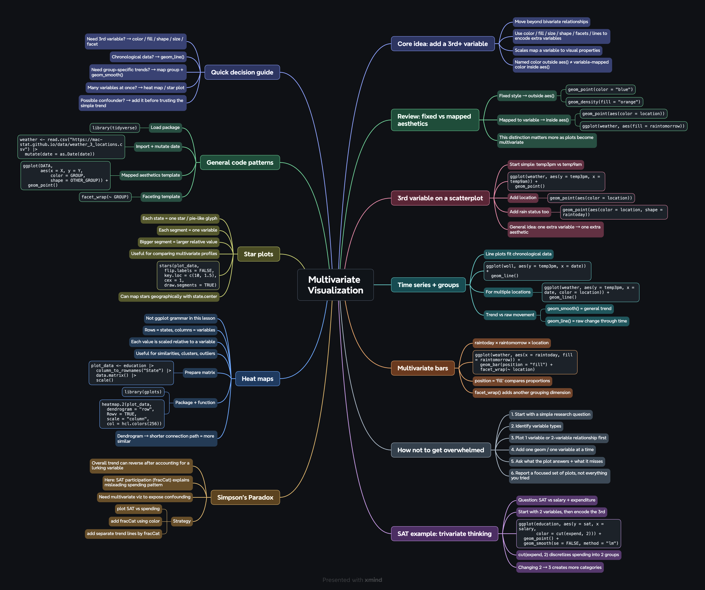
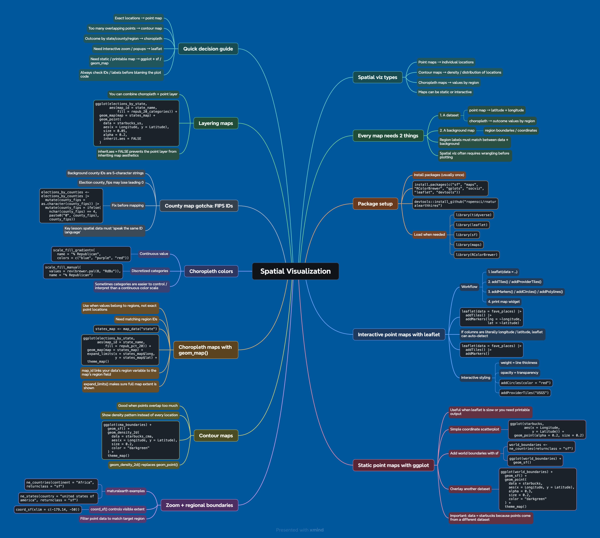

::: {.pcl-page}

# Pre-Class Learning Summaries

A collection of the mind maps I made before class to organize what I was learning.

## 01 · Introduction to Data Science

[{width=90%}](Introduction_to_Data_Science.png){target="_blank"}

## 02 · RStudio + HW1

[{width=90%}](RStudio_HW1.png){target="_blank"}

## 03 · Univariate Visualization

[{width=90%}](Univariate_Visualization.png){target="_blank"}

## 04 · Bivariate Visualization

[{width=90%}](Bivariate_Visualization.png){target="_blank"}

## 05 · Multivariate Visualization

[{width=90%}](Multivariate_Visualization.png){target="_blank"}

## 06 · Spatial Visualization

[{width=90%}](Spatial_Visualization.png){target="_blank"}

:::
